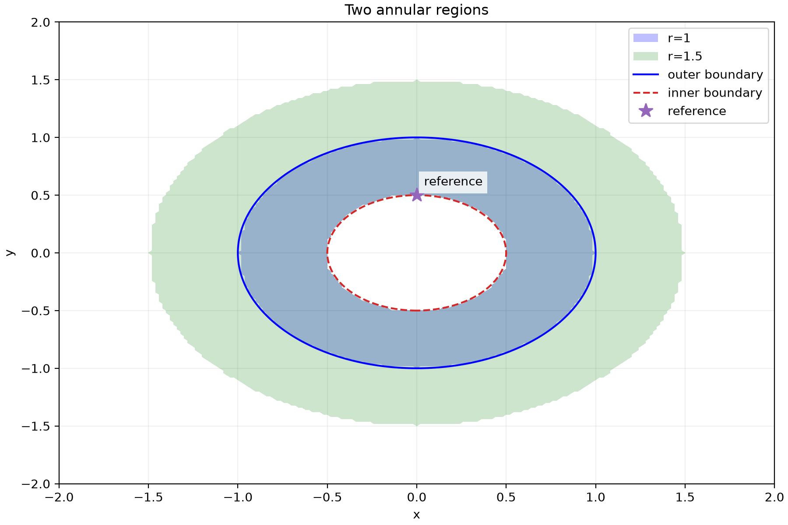

# NLCAS Notebook

**A research notebook for natural-language computer algebra.**

NLCAS Notebook connects mathematical expressions, CAS operations, numerical
experiments and manuscript output in a notebook with recorded provenance.
It is the Research Notebook prototype associated with the APIEMS2026 paper
*An AI-Enhanced Research Notebook Platform for Theoretical Studies*.

- [日本語の導入・機能説明](README_jp.md)
- [Detailed introduction and setup (English)](README_en.md)
- [User guide](docs/user_guide.md) · [Setup guide](docs/setup_guide.md)

## What it does

- Register expressions through mathematical text or handwritten input.
- Request operations in natural language. Validated common operations are
  translated deterministically into Maxima or Julia backend commands.
- Preserve expressions, assumptions, steps and branches in a notebook timeline.
- Fork theory expressions into numerical tasks and retain source references.
- Overlay curves, contours, inequality regions and reference points using
  declarative plot specifications; export figures and sampled data.
- Export research notes to TeX.

The LLM interprets intentions and proposes specifications. Numerical code
outside the deterministic templates has a separate code-review gate.

## Reproducible plotting examples

Start with [general plotting examples](docs/scenarios/scenario_cartesian_plots.md)
for a parameter comparison and a nonlinear region with a hole. These include
complete specifications, expected results and figures generated by the
common renderer.



The public snapshot includes general-purpose examples. Conference data,
paper drafts, presentation files, private working notebooks and internal
measurement/handoff logs are excluded.

## Get started

The tested development stack uses Python 3.14, Maxima 5.49 and Julia 1.12.
Local LLMs use separately configured Ollama or OpenAI-compatible endpoints.
Model weights are not included. See the setup guide for platform-specific
requirements and Windows/Linux options.

On macOS with Homebrew installed, from the project directory:

```bash
./setup.sh
./scripts/start.sh
```

Open **http://localhost:8000/notebook.html**. The first startup downloads
KaTeX rendering assets. Configure model endpoints for your own environment;
the public snapshot uses a localhost Adviser endpoint rather than the
developer's LAN server. To use the plots, install the numeric environment
created by `setup.sh` and save the notebook before running a numeric task.

## Project lineage

The successor project is [Out-of-Order CAS (OOCAS)](https://github.com/riversideheroyoukey/oocas).
This repository preserves the earlier Research Notebook implementation and
its APIEMS2026 workflows. Access to the successor depends on that
repository's visibility and your account permissions.

## Status and licensing

This is a research prototype. Sampling-based plots do not prove feasibility
or optimality. See [plotting limits](docs/developer_manuals/36_cartesian_plot_layers.md)
and [known issues](KNOWN_ISSUES.md).

A license for the original project code is **not yet selected**; this
repository does not declare an open-source license.
[Third-party notices](THIRD_PARTY_NOTICES.md) apply separately.

Software citation metadata: [CITATION.cff](CITATION.cff).

Maintainer: [riversideheroyoukey](https://github.com/riversideheroyoukey).
[Publication preparation and verification](docs/github_publication.md).
