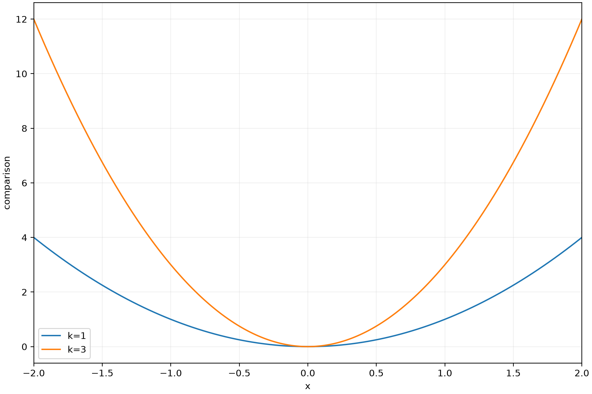
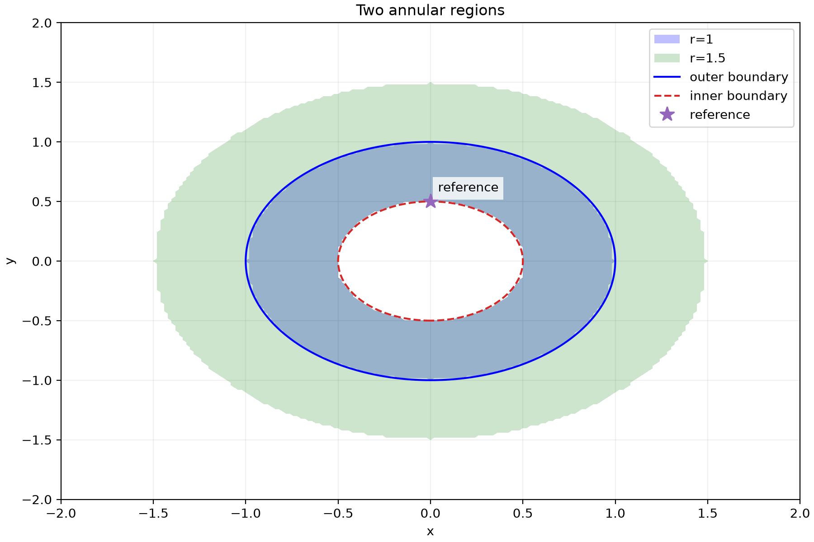

# 汎用作図の再現例 — 曲線比較・非線形領域・注目点

更新: 2026-11-02。特定のスライドに依存しない、共通作図機能の操作手順。
[利用者ガイド](../user_guide.md#複数の式領域を組み合わせたグラフ)・
[JSON仕様とAPI](../developer_manuals/36_cartesian_plot_layers.md)を併読する。
以下の自然言語は依頼例で、Adviserの返答内容は毎回確認する。

## 準備と共通の流れ

1. Maximaの新規セッションを作り、下記の式を順番に登録する。式番号は実際のものを確認する。
2. セッションを名前を付けて保存する。数値実行環境とAdviserの設定を確認する。
3. 式を選択し「💬 対話で仕様を確定」を開く。依頼を入力する。
4. 提案の参照式・軸範囲・標本点数・固定値・保存形式を確認し、必要なら修正を依頼する。
5. 仕様承認→コード生成→実行。共通作図に対応する仕様では手作業でコードを追加しない。
6. 図と警告を確認し、結果カードから図・CSV・`plot.json`を保存する。セッションも再保存する。

数式の登録は入力欄で行う。式番号参照のJSON例は開発仕様にあり、Adviserを使わずAPIからも実行できる。

## A. 1本の式からパラメータ比較

新規ノートで `k*x^2` を登録（以下ではE1）。依頼例:

> E1をx=-2から2、201点で描いて。k=1とk=3を同じ図で比較し、凡例を付けて。
> PNG・SVG・PDFを保存したい。

English prompt:

> Plot E1 over x from -2 to 2 using 201 samples. Overlay k=1 and k=3 with a
> legend, and export PNG, SVG and PDF.

確認項目:

- `presentation.kind` は `cartesian`、横軸はxのみ、固定入力kは1。
- `line`が2個、両方の `expr_id` がE1、2個目だけ `fixed_values: {"k":3}`。
- 原点で両曲線は0、x=±2ではそれぞれ4と12。左右対称の放物線になる。
- `layer_01.csv`・`layer_02.csv` は `x,value` の列を持つ。

文書のJSON仕様を共通作図で実行した出力例:

## B. 穴のある領域・別条件・等高線・点

別の新規ノートに次を登録する。実際の式番号が異なれば依頼と仕様を読み替える。

| 式番号の例 | 登録する数式 |
|---|---|
| E1 | `x^2+y^2<=r^2` |
| E2 | `x^2+y^2>=1/4` |
| E3 | `x^2+y^2=1` |
| E4 | `x^2+y^2` |
| E5 | `1/4` |
| E6 | `0` |
| E7 | `1/2` |

> E1とE2を両方満たす領域を青で塗って。r=1を基準、r=1.5を別の緑の領域として重ねて。
> E3の境界と、E4がE5になる等高線も描いて。横座標E6・縦座標E7に星印を付けて。
> x,yとも-2から2、各201点。PNG・SVG・PDFを出力して。

確認項目:

- 2個の `region` はそれぞれE1・E2の**共通部分**。2個目だけr=1.5で上書き。
- `contour` のE3は等式なのでレベル0。E4のレベルは `{"expr_id":"E5"}`。
- `point` は `x:{"expr_id":"E6"}, y:{"expr_id":"E7"}`。引用符だけの `"E6"` は座標参照として無効。
- 原点は穴の内側なので両領域のCSVで `inside=0, valid=1`。
  半径1/2〜1が基準領域、1/2〜1.5が別条件の領域になり、点は(0,1/2)に現れる。
- 領域のCSV列は `x,y,inside,valid`、等高線CSVは `x,y,value`。
  等高線のCSVは曲線の頂点列ではなく、格子上の場の値。
- 領域に穴があること・格子上の内外を確認する。図だけで境界の包含や連続集合を証明しない。

完全なJSONは[開発仕様の2軸例](../developer_manuals/36_cartesian_plot_layers.md#complete-two-axis-example)にある。
格子予算は201×201×5=202005で上限200万以内。

文書のJSON仕様を共通作図で実行した出力例。現行表示は縦横の単位長を揃えないため、
円形の領域が横長に見える。座標値・格子CSVで形状を確認する。

この公開用手順は一般的な曲線比較と非線形領域の例に限定する。発表用データは同梱しない。
